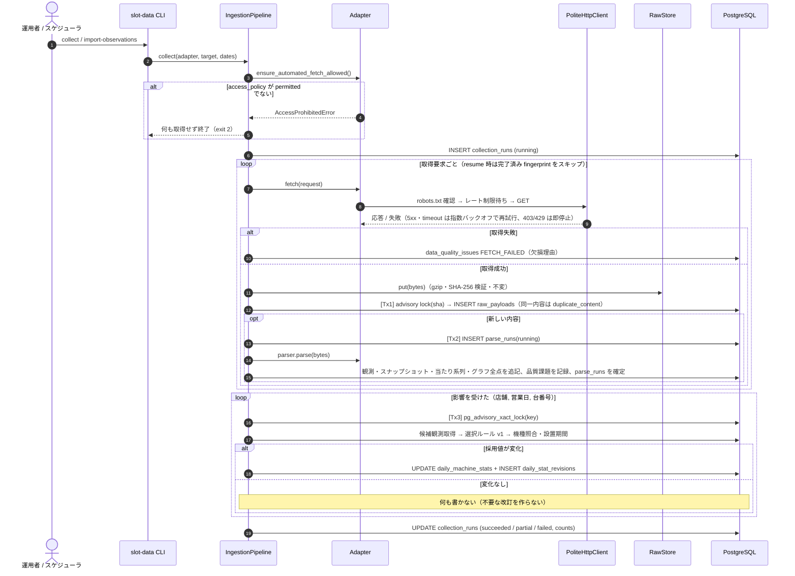

# アーキテクチャ

## 1. 全体像

```
取得元（サイト / 人が記録したファイル）
   │ fetch（アダプター: 許可ゲート・robots・レート制限・再試行）
   ▼
原本ストア（rawstore://sha256/..  gzip・内容アドレス・不変）
   │ raw persist（ファイル → raw_payloads 行の順。ファイル保存失敗なら停止）
   ▼
parse（パーサー名＋版を parse_runs に記録。解析不能でも原本とエラーは残す）
   │ validate（範囲・符号・営業日・順序・軸／単位。致命的なら quarantined）
   │ normalize（台番号・営業日・値の状態・原文/ラベル/単位の保持）
   ▼
source_observations / machine_snapshots / bonus_event_series+events / slump_series+points（追記専用）
   │ reconcile（店舗＋営業日＋台番号ごとに advisory lock。選択ルール v1）
   ▼
daily_machine_stats（最新採用値・UPDATE）＋ daily_stat_revisions（変化時のみ追記）
   │ publish
   ▼
export（CSV / Excel / Parquet）・配置特徴（layout features）・監査
```

| 層 | モジュール | 役割 |
|---|---|---|
| ドメイン | `domain/` | 列挙値、指標定義、UUIDv7、営業日計算（DB 非依存） |
| モデル | `models/` | SQLAlchemy 2 ORM（制約・索引を含む）。マイグレーションは `alembic/` |
| 中間表現 | `schemas/parsed.py` | パーサー出力（Pydantic 2）。値の状態を型で表す |
| アダプター | `adapters/` | サイト別 fetch / parse。`pscube`・`daidata_online` は許可ゲートで停止、`manual` は手動インポート |
| 取り込み | `ingestion/` | パイプライン、HTTP クライアント、パーサー登録簿 |
| 正規化 | `normalization/` | 検証（純粋関数）と観測・系列の追記保存 |
| 照合 | `reconciliation/` | 採用値決定・改訂・設置期間 |
| 配置 | `layout/` | CSV/Excel 取り込み、位置関係・角台の算出、日付別の配置特徴 |
| 品質 | `quality/` | 理由コード、課題記録、監査 |
| 出力 | `exports/` | CSV / Excel / Parquet |
| 保存 | `storage/` | 原本ストア、バックアップ／リストア |
| サービス | `services/` | 実行コンテキスト、マスター操作（CLI・将来の API が共通で使う） |
| CLI | `cli/main.py` | `slot-data` コマンド |
| 観測性 | `observability/` | 構造化ログ（ジョブ ID・原本 ID・店舗・営業日・台番号・段階）、秘密情報のマスク |

## 2. 収集元から DB までのシーケンス



手動インポート（`import-observations`）は fetch の代わりにファイルを読み、以降は同じ経路を通る。

## 3. 更新・改訂・冪等性の仕様

### 3.1 トランザクション境界と障害時の復旧

| 段階 | 境界 | 途中で落ちた場合 |
|---|---|---|
| 原本ファイル保存 | ファイル（一時ファイル → 検証 → rename） | 一時ファイルのみ残る。DB 未登録なので正規化されない |
| raw_payloads 登録 | Tx1 | ファイルはあるが行が無い → 監査で `RAW_ORPHAN_FILE`。再取得すると同じファイルを再利用する |
| 解析・観測追記 | Tx2 | 原本はあるが成功解析が無い → `reparse --pending` で復旧（監査で `RAW_UNPARSED`） |
| 採用値更新 | Tx3（キー単位） | 観測はあるが採用値が古い → `reconcile --hall --from --to` で再計算（冪等） |
| 収集ジョブ | collection_runs | `collect --resume <run_id>` で原本保存済みの要求をスキップして再開 |

### 3.2 冪等性

- 同一内容の再投入: 取得イベント（raw_payloads 行）は毎回残す。店舗・取得元・SHA-256 が同じなら `duplicate_content` として解析しない。内容ハッシュ単位の advisory lock で並行投入も直列化する。
- 同一原本・同一パーサー版: `UNIQUE(raw_payload_id, parser_name, parser_version)` により二重解析しない。
- 品質課題: `UNIQUE(issue_code, dedup_key)` により再実行しても重複起票しない。
- 照合: 採用値（指標・値の状態・確定段階・機種・設置・品質）が前回と同じなら何も書かない。採用元の取得元が変わっただけで値が同じ場合も改訂しない。

### 3.3 再解析

`reparse` は原本に記録したパーサー名の現行版で解析する。新しい版の観測は追記され、照合では「各原本について最新の成功解析」の観測だけを候補にする。旧版の観測は残る（監査・比較用）。

### 3.4 採用値の決定（選択ルール v1）

1. 候補: 各原本の最新成功解析に由来し、quarantined でない観測。各取得元から最新 observed_at の 1 件を取る。
2. 順位: 確定段階 > 取得元優先度（設定） > 品質（valid > warning） > 完全性（観測値の数） > 鮮度。
3. 指標は採用した 1 観測から一括で取る。取得元をまたいで指標を混ぜない。
4. 同じ確定段階で、異なる取得元の値が食い違えば `SOURCE_MISMATCH`（差分付き）を記録し、日次の品質を warning にする。
5. 有効な手動訂正を最後に重ねる。元の観測は改変しない。

### 3.5 確定段階

| 状態 | 条件 |
|---|---|
| provisional | 採用観測の observed_at が閉店時刻（未設定なら営業日終端）より前 |
| final_candidate | 閉店後の観測。閉店後でも自動では final にしない |
| final | 同一取得元で同じ値の final_candidate 観測（同一内容の再取得を含む）が `settle_hours` 以上続いた |
| is_corrected（フラグ） | final_candidate / final に達した後に値が変わった。改訂理由は `correction`。訂正後は final_candidate に戻り、再び安定するまで待つ |

改訂理由: `initial`（初回）/ `source_update`（同じ取得元で値が変化）/ `source_switch`（採用元の取得元が変わり値も変化）/ `status_change`（値は同じで確定段階または品質が変化。例: 他の取得元との不一致で warning になった）/ `correction`（final_candidate 以降の値変化）/ `manual_correction`。

## 4. 時刻の扱い

| 項目 | 意味 |
|---|---|
| `fetched_at` | こちらが取得した時刻（raw_payloads） |
| `source_reported_at` | 取得元が示すデータ時点（「○時更新」など） |
| `observed_at` | 観測値が表す時点（手動入力では入力者が記録した時点） |
| `business_date` | 店舗の営業日。`business_day_cutoff` より前のローカル時刻は前日 |

保存はすべて UTC の TIMESTAMPTZ。DB 接続のセッションタイムゾーンは UTC に固定する。
