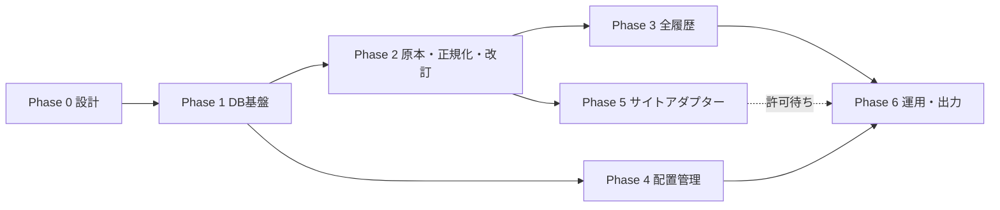

# 実装計画と進捗（Phase 0〜6）

状態: ✅ 完了 / 🟡 一部完了（ブロッカーあり）/ ⬜ 未着手。最終更新 2026-10-21。

| Phase | 状態 | タスク | 完了基準 | 成果物 |
|---|---|---|---|---|
| 0 設計レビュー | ✅ | 整合性レビュー、ER 図、テーブル定義、有効期間の定義、収集元契約、ADR、データフロー、計画 | 指摘の解消方法または未決定事項として記録 | `spec_review.md` `erd.md` `schema_dictionary.md` `architecture.md` `source_contracts.md` `decisions/` |
| 1 DB 基盤 | ✅ | ORM 26 テーブル、初期マイグレーション（btree_gist・排他制約・トリガー）、テスト DB | upgrade → downgrade → upgrade が通る、`alembic check` で差分 0、制約テストが通る | `models/` `alembic/` `tests/integration/test_constraints.py` |
| 2 原本・正規化・改訂 | ✅ | 原本ストア、raw_payloads、解析版管理、観測追記、検証、採用値更新、改訂、冪等性、並行制御 | 再投入・複数回取得・訂正・不一致・再解析・並列のテストが通る | `storage/` `ingestion/` `normalization/` `reconciliation/` `tests/integration/test_pipeline.py` |
| 3 全履歴 | ✅ | 当たり履歴系列、スランプ全点（点数無制限・バッチ挿入）、推定系列、営業中スナップショット | 12,346 点の全点保持、旧系列の保持、順序訂正の検出 | `normalization/persist.py` |
| 4 配置管理 | ✅ | CSV/Excel 取り込み、検証、差分プレビュー、公開、位置関係・角台、手動補正、過去日の配置再現 | 版の切り替え・台番号変更・過去日の再現・不正 CSV 非反映のテストが通る | `layout/` `tests/integration/test_layout.py` `tests/unit/test_geometry.py` |
| 5 サイトアダプター | 🟡 | 利用条件の実地確認 ✅、許可ゲート ✅、HTTP 基盤 ✅、手動インポート ✅、**P's CUBE（ぱちタウン経由のブラウザ巡回）✅**、機種一覧・機種画面パーサー ✅、台詳細パーサー ✅（2026-10-26）、台データオンライン ⬜（許可なし） | 実データのフィクスチャテストが通る | `adapters/pscube/` `tests/unit/test_pscube_parsers.py` `tests/integration/test_pscube_crawl.py` |
| 6 運用・出力 | ✅ | CLI、スケジューリング（`schedule --once`）、再試行、バックフィル、途中再開、CSV/Excel/Parquet、監査、バックアップ/復元、運用文書 | 出力・監査・復元・CLI の E2E テストが通る | `cli/` `exports/` `quality/audit.py` `storage/backup.py` `docs/operations.md` |

## Phase 5 の残作業

**P's CUBE（2026-10-23 時点）**

1. 台詳細が表示された状態の HTML を取得する（VS Code の「P's CUBE 台詳細までの確認（目視・ぱちタウン経由）」を、人が 1 ステップずつ実行すると HTML が `var/walkthrough/` に保存される）。
2. その HTML をフィクスチャにして `MachineDetailParser` を実装し、バージョンを上げる。BIG→bb_count、REG→rb_count、累計ゲーム→total_games、最終ゲーム→last_games、出枚数→net_medals（▲ は負）、特賞履歴→当たり履歴。確率・BIG過去最高は原文を参考値として保持。
3. 保存済みの台詳細原本を `slot-data reparse` で取り込む。
4. 収集用 PC で定期実行し、error(451) が続くかを確認する。続く場合はアンジェロ社へ相談する。

**台データオンライン**: 許可が無いため自動取得しない（手動インポートのみ）。

## 仕様の必須テストケースとの対応

| 必須テストケース | テスト |
|---|---|
| 同一原本の再投入 | `test_pipeline.py::test_reimport_same_raw_is_idempotent`, `::test_parallel_import_of_same_file` |
| 同日複数回取得 | `test_pipeline.py::test_multiple_fetches_same_day_keep_snapshots`, `::test_value_regression_detected` |
| 閉店後訂正 | `test_pipeline.py::test_correction_after_close_and_settle_to_final` |
| 異なるサイト間の値不一致 | `test_pipeline.py::test_source_mismatch_recorded_and_priority_applied` |
| 機種入替 | `test_pipeline.py::test_model_swap_splits_installations`, `test_constraints.py::test_installation_periods_cannot_overlap` |
| 台番号変更 | `test_layout.py::test_layout_switch_and_past_reproduction`（renumbered_candidates） |
| 配置版切替 | `test_layout.py::test_layout_switch_and_past_reproduction`, `::test_cannot_publish_overlapping_or_earlier_period` |
| 当たり履歴の順序訂正 | `test_pipeline.py::test_bonus_history_order_correction_keeps_all_series` |
| グラフ座標の全点保持 | `test_pipeline.py::test_slump_all_points_kept_without_limit` |
| 途中失敗後再開 | `test_collect.py::test_collect_partial_failure_then_resume`, `::test_pending_raw_recovered_by_reparse` |
| 原本からの再解析 | `test_pipeline.py::test_reparse_with_new_parser_version` |
| 取得不能・NULL | `test_pipeline.py::test_import_creates_observation_stat_and_revision`, `test_ops.py::test_export_formats_keep_nulls_and_sources`, `test_collect.py`（FETCH_FAILED） |
| 並列収集競合 | `test_pipeline.py::test_parallel_reconcile_is_serialized`, `::test_parallel_import_of_same_file` |
| バックアップ復元 | `test_ops.py::test_backup_and_restore_roundtrip` |

## 後続フェーズ（初期範囲外）

- 予測モデル・設定推測（`analysis_results` に根拠付きで保存する。確定設定としては扱わない）
- GUI / API
- 大規模化への対応（時系列パーティショニング、Parquet の定期エクスポート、オブジェクトストレージの `RawStore` 実装）
